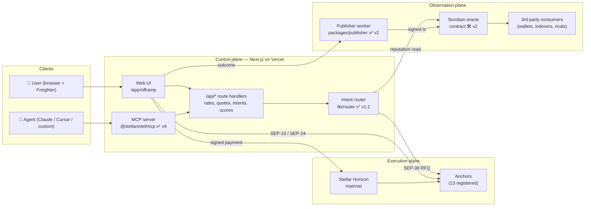
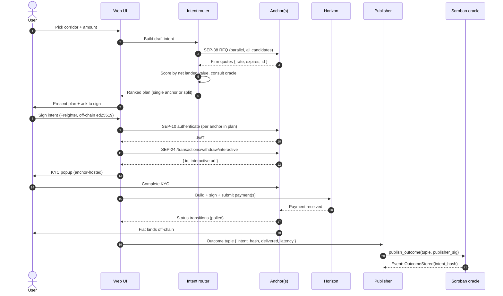
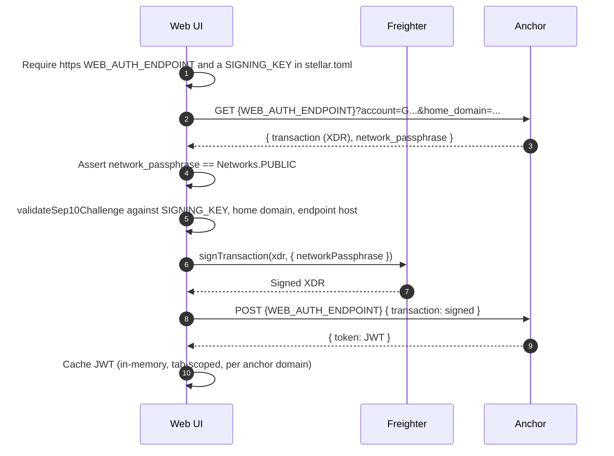
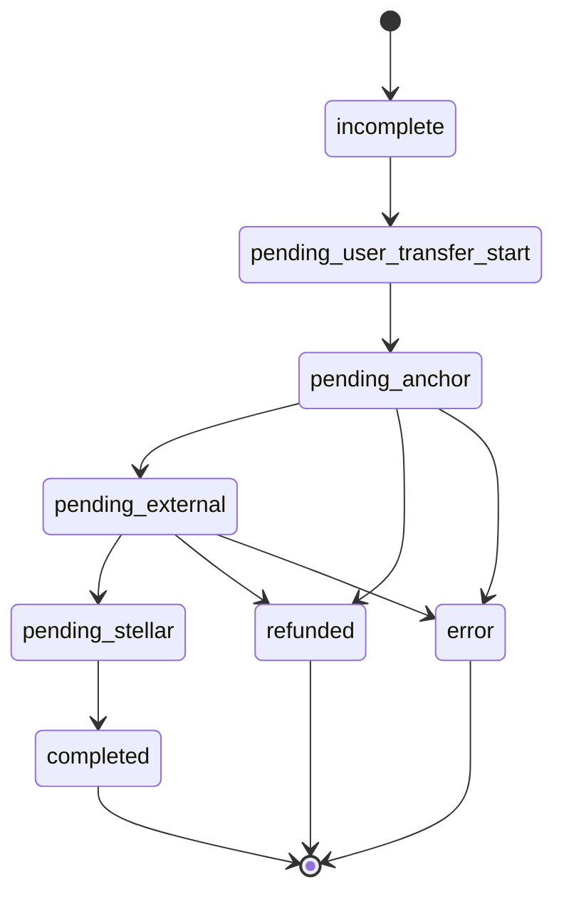
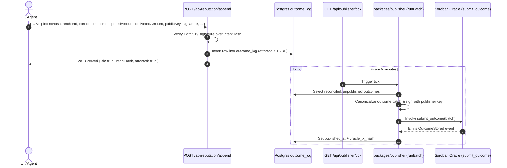
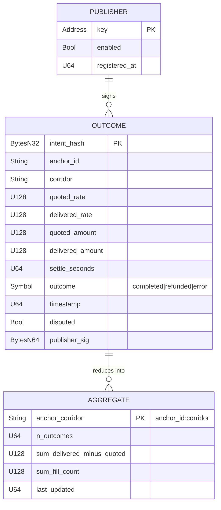

# Stellar Intel — Architecture

> How the pieces fit together. This document is the map a new contributor
> reads before opening a PR, the reviewer consults before approving one, and
> the reference contributors and integrators read to understand what is actually built.
>
> Scope: the intent router, the reputation write path, the Soroban oracle,
> the MCP/agent surface, and the SEP-10/24/38 flow. Where something ships
> today it is marked ✅; where it is planned it is marked 🛠️ and the
> milestone wave is named.

**Last reviewed:** 2026-10-18

---

## Table of contents

1. [System overview](#1-system-overview)
2. [Component inventory & repo layout](#2-component-inventory--repo-layout)
3. [The intent lifecycle](#3-the-intent-lifecycle)
4. [SEP-10 / SEP-24 / SEP-38 — the anchor handshake](#4-sep-10--sep-24--sep-38--the-anchor-handshake)
5. [Intent router internals](#5-intent-router-internals)
6. [Reputation write path](#6-reputation-write-path)
7. [Soroban oracle](#7-soroban-oracle)
8. [MCP / agent surface](#8-mcp--agent-surface)
9. [Trust boundaries & invariants](#9-trust-boundaries--invariants)
10. [File map](#10-file-map)
11. [Environment variable schema](#11-environment-variable-schema)

---

## 1. System overview

Stellar Intel is three planes sharing one vocabulary (the intent):

- **Control plane** — the Next.js app (web UI + API routes) and the MCP server.
  Both consume the same router and oracle primitives.
- **Execution plane** — the 13 registered anchors (listed in `constants/anchors.ts`) reached
  over SEP-10/24/38, and the Stellar ledger itself for payment submission.
- **Observation plane** — the Soroban reputation oracle on testnet (mainnet gated — see docs/MAINNET_LAUNCH.md), fed by a
  publisher worker; read permissionlessly by any third party.



The user's wallet is the only thing that holds keys. The app holds none; the
router holds none; the publisher holds one key, used only to submit reputation
writes to Soroban — never to move user funds.

---

## 2. Component inventory & repo layout

| Module                      | Role                                                                                                                           | Path                                                                | Status                  |
| --------------------------- | ------------------------------------------------------------------------------------------------------------------------------ | ------------------------------------------------------------------- | ----------------------- |
| **Offramp page**            | The end-user surface. Corridor select → rate table → execute drawer → status tracker.                                          | `app/offramp/page.tsx`                                              | ✅                      |
| **RateTable**               | Sortable list of live anchor quotes for the selected corridor.                                                                 | `components/offramp/RateTable.tsx`                                  | ✅                      |
| **ExecuteDrawer**           | Interactive off-ramp flow walking steps from idle to done (SEP-10 auth, SEP-38 quote, SEP-24/SEP-6 KYC, payment build & sign). | `components/offramp/ExecuteDrawer.tsx`                              | ✅                      |
| **StatusTracker**           | Polls `/transaction?id=...` and renders the SEP-24 state machine.                                                              | `components/offramp/StatusTracker.tsx`                              | ✅                      |
| **Anchor registry**         | Typed list of anchors + corridors + assets. Single source of truth.                                                            | `constants/anchors.ts` (data), `lib/stellar/anchors.ts` (accessors) | ✅                      |
| **SEP-1 resolver**          | `stellar.toml` discovery, TRANSFER_SERVER_SEP0024 + WEB_AUTH_ENDPOINT extraction.                                              | `lib/stellar/sep1.ts`                                               | ✅                      |
| **SEP-10 client**           | Challenge fetch, verification, Freighter sign, JWT exchange. Network pinned to mainnet.                                        | `lib/stellar/sep10.ts`                                              | ✅                      |
| **SEP-24 client**           | `/fee`, `/transactions/withdraw/interactive`, `/transaction` wrappers. 10s timeout.                                            | `lib/stellar/sep24.ts`                                              | ✅                      |
| **Horizon helper**          | Build + sign + submit the user's withdrawal payment on the Stellar ledger.                                                     | `lib/stellar/horizon.ts`                                            | ✅                      |
| **Freighter hook**          | Wallet connection state + account + network.                                                                                   | `hooks/useFreighter.ts`                                             | ✅                      |
| **Rates hook**              | SWR-powered parallel rate aggregation across all anchors on a corridor.                                                        | `hooks/useAnchorRates.ts`                                           | ✅                      |
| **Status hook**             | SWR polling loop keyed by `[transferServer, transactionId, jwt]`.                                                              | `hooks/useWithdrawStatus.ts`                                        | ✅                      |
| **SEP-38 client**           | Firm-quote RFQ against anchors; supersedes the `/fee` + stored-rate approach.                                                  | `lib/stellar/sep38.ts`                                              | ✅                      |
| **Intent canonicalizer**    | Deterministic JSON → hash → sign.                                                                                              | `lib/intent/`                                                       | ✅                      |
| **Intent router (solver)**  | Scores candidate anchors by net landed value; returns a single-anchor or split plan.                                           | `lib/router/`                                                       | ✅                      |
| **Reputation store**        | Outcome storage + composite scoring (SQLite dev / Postgres prod).                                                              | `lib/reputation/`                                                   | ✅                      |
| **Publisher worker**        | Signs outcome tuples and invokes the Soroban contract. Scheduler entry point: `app/api/publisher/tick/route.ts`.               | `packages/publisher/`                                               | ✅ testnet              |
| **Soroban oracle contract** | On-chain reputation storage + read helpers.                                                                                    | `contracts/reputation/`                                             | ✅ testnet · 🛠️ mainnet |
| **MCP server**              | Exposes router + oracle as MCP tools.                                                                                          | `packages/mcp/`                                                     | ✅ basic                |
| **SDK**                     | Typed client for the API + MCP.                                                                                                | `packages/sdk/`                                                     | ✅ built, unpublished   |

> All module paths are namespaced — no runtime concern spans two modules in
> opposite directions. `lib/stellar/*` has no dependencies on `lib/router/*`
> or `packages/publisher/*`; `components/*` only imports from `lib/*` and `hooks/*`.

---

## 3. The intent lifecycle

An **intent** is the user's signed, canonicalized statement of purpose. It is
the atomic unit every other component is built around.

The intent core and envelopes are defined by Zod schemas in `types/intent.ts` (`OfframpIntentSchema`, `SignedIntentEnvelopeSchema`, `IntentV1Schema`, `CanonicalIntentV1Schema`) and `lib/intent/offramp.ts` (`IntentSchema`).

An intent carries:

- `anchorId`, `corridorId`, `amount`, and `publicKey` (for off-ramp intents)
- Replay protection via random nonces (`nonce`)
- Canonical Ed25519 signatures over the normalized JSON hash (`intentHash`)

Canonicalization rules live in `docs/CANONICAL_JSON.md` (sorted keys, no
trailing whitespace, fixed UTF-8 encoding, integer normalization). The hash is
what everyone commits to: the user when they sign, the anchor when they
honour a quote, the publisher when they write the outcome.

### Lifecycle



The lifecycle is implemented end to end: SEP-38 firm quotes, SEP-10 authentication, interactive SEP-24 / SEP-6 withdrawal with payment submission, and outcome reporting via `/api/reputation/append`, which the publisher then mirrors to the on-chain oracle.

---

## 4. SEP-10 / SEP-24 / SEP-38 — the anchor handshake

### 4.1 SEP-1 — discovery ✅

`getTransferServer(domain)` and `getWebAuthEndpoint(domain)` fetch and cache
the anchor's `stellar.toml`, pulling `TRANSFER_SERVER_SEP0024` and
`WEB_AUTH_ENDPOINT`. Everything downstream is keyed off those two URLs.

### 4.2 SEP-10 — authentication ✅



Implemented in `lib/stellar/sep10.ts`. Key invariants:

- **Network pinning.** `fetchSep10Challenge` throws if the anchor's
  `network_passphrase` is not mainnet. This blocks a malicious anchor from
  trying to phish a testnet-scoped signature into a mainnet replay.
- **The challenge is verified before Freighter sees it.** `validateSep10Challenge`
  parses the XDR with the SDK and applies two tiers of checks. `signChallenge`
  only accepts an object the validator produced.
  - _Strict_ — these stop a hostile or compromised anchor presenting a real
    transaction (say, a payment) as the "login": mainnet passphrase; sequence
    number 0, so the envelope can never be submitted; source account is the
    toml's `SIGNING_KEY`, with a valid `SIGNING_KEY` signature over the mainnet
    hash; every operation is `manage_data`; the first is sourced from the
    connected wallet and keyed `<d> auth`, where `d` is the domain the toml was
    fetched from, the registry home domain, or the `WEB_AUTH_ENDPOINT` host;
    later operations are sourced from `SIGNING_KEY` (or are `client_domain`);
    timebounds are present, finite, current (±5 min skew) and expire within an
    hour.
  - _Tolerated_ — deviations seen from honest mainnet anchors that cannot move
    funds on a sequence-0 transaction: no `web_auth_domain` operation, or one
    naming any of the allowed domains instead of exactly the endpoint host; a
    text memo (none and id are the spec; hash and return memos are refused).
    The SDK's `WebAuth.readChallengeTx` rejects these, which is why it is not
    used directly.
- **Fail closed on the toml.** No `SIGNING_KEY`, or a `WEB_AUTH_ENDPOINT` that
  is not `https://`, stops authentication before any request is made. Every
  refusal surfaces as `Sep10ChallengeRejectedError` with a message the
  `authenticating` step shows as-is.
- **JWT is scoped.** The JWT is used only as the `Authorization: Bearer …`
  header on that anchor's SEP-24 endpoints. It is never passed cross-anchor.
- **Ephemeral.** No JWT is persisted to localStorage or IndexedDB.

### 4.3 SEP-24 / SEP-6 — withdrawal execution ✅

`ExecuteDrawer` (`components/offramp/ExecuteDrawer.tsx`) manages the interactive withdrawal lifecycle across discrete steps defined in `STEP_LABELS` (`ExecuteDrawerStep`):

| Step             | Substrate           | What happens                                                                                           | Failure recovery                                                        |
| ---------------- | ------------------- | ------------------------------------------------------------------------------------------------------ | ----------------------------------------------------------------------- |
| `idle`           | —                   | Ready state awaiting execution start.                                                                  | Initial baseline.                                                       |
| `authenticating` | SEP-10              | Fetch challenge, sign with Freighter, exchange for JWT.                                                | Retry in-place; on rejection, return to idle.                           |
| `quoting`        | SEP-38              | Lock in a firm quote with the anchor when advertised.                                                  | Retry quote or fall back to standard flow.                              |
| `initiating`     | SEP-24              | `POST /transactions/withdraw/interactive` with JWT.                                                    | Surface anchor error; retry with fresh JWT.                             |
| `kyc`            | Anchor-hosted popup | Open interactive anchor URL in popup for user KYC.                                                     | On popup close without success, poll `/transaction` for `pending_user`. |
| `form`           | Direct UI Form      | Render embedded KYC / transfer info form for SEP-6 endpoints.                                          | Form input validation; re-submission.                                   |
| `building`       | Horizon             | `buildWithdrawPayment` — construct the payment to the anchor's receiving address at the quoted amount. | Fee estimation retries; network reselect.                               |
| `signing`        | Freighter           | User signs the payment XDR in Freighter.                                                               | User-reject returns to idle; signature-required errors surface.         |
| `done`           | —                   | Drawer closes; `onExecuteStarted` hoists tracking data to the page; `StatusTracker` mounts.            | Terminal success state.                                                 |
| `error`          | —                   | Error state with classified error messages and retry action.                                           | In-place retry or cancel to return to idle.                             |

**The `done` hoist is the fix for the tracker-never-mounts bug (#002).**
Before `commit 45a82eb` the drawer completed the withdrawal but never told the
page; after, the drawer closes on success and the tracker owns the viewport
with a live `transactionId`.

### 4.4 SEP-24 status machine ✅

The polling loop in `hooks/useWithdrawStatus.ts` maps raw anchor status strings (`WithdrawStatusValue`) into canonical app-wide status states (`WithdrawStatus` in `types/index.ts`):



Terminal states (`completed`, `refunded`, `error`) stop the SWR poll. Non-
terminal states poll on a 5-second cadence with exponential backoff on
consecutive failures (hardening lands with v1.1).

### 4.5 SEP-38 — firm quote RFQ ✅ v1.1

Today's rate aggregation uses SEP-24 `/fee` + a cached exchange rate, which is
correct enough for comparison but not firm. v1.1 replaces this with SEP-38:

```
POST /sep38/quote
{ sell_asset, sell_amount, buy_asset, context: "sep24" }
→ { id, price, expires_at, total_price, fee }
```

The returned `id` is then passed as `quote_id` to `POST /transactions/withdraw/interactive`
so the anchor is contractually bound to the price. This is the moment the
product moves from "useful rate page" to "firm execution layer" — and it is
also what makes every future reputation write comparable (we have a stated
quote to compare the delivered amount against).

---

## 5. Intent router internals ✅ v1.2

The router takes a draft intent and returns a **plan**: one or more anchors,
each with a quoted amount, ranked so that the top result maximizes expected
net landed value.

### Scoring

For each candidate anchor `a` on the intent's corridor, and each amount chunk
`n` the router considers:

```
score(a, n) = grossRate(a, n)            // SEP-38 firm rate
            − feeFrac(a, n)              // anchor fee as fraction of sell
            − slippagePenalty(a, n)      // historical quote → delivered delta
            − failurePenalty(a)          // 1 − fillRate(a)
            × settlementDiscount(a)      // 1 / (1 + latency_hours × λ)
```

The `slippagePenalty`, `failurePenalty`, and `settlementDiscount` inputs are
all read from the reputation oracle — **not** from the anchor's self-report.
That inversion is the whole point: the anchor cannot score itself.

### Splitting

For intents above a threshold (configurable per corridor, default $5,000 USDC),
the router considers splitting across up to `maxAnchors` anchors. Split is
**only** proposed when:

1. At least two anchors have quoted the corridor in the last 30 seconds.
2. The sum of their chunks' `score` is strictly greater than the best single
   anchor's score, net of the fixed-fee cost of the second leg.
3. Both anchors have a `fillRate` above a floor (default 0.9).

If any of the three fails, the router returns a single-anchor plan. We never
propose a split to look sophisticated — splits exist when they are strictly
better.

### Determinism

The router is deterministic given the same inputs and the same oracle snapshot
root. A plan is replayable from its inputs, which matters for dispute
resolution.

---

## 6. Reputation write path ✅ testnet

Every terminal intent (completed, refunded, or error) produces an **outcome
tuple** the publisher writes to the Soroban oracle.



### Properties

- **User-witnessed, not anchor-claimed.** The outcome's `delivered_amount`
  comes from the SEP-24 `/transaction` response _and_ (where possible) a
  ledger lookup of the `stellar_transaction_id`. The user's wallet signs the
  trigger. An anchor cannot inflate its own delivery numbers.
- **Publisher cannot invent.** The publisher key signs transport, not
  content. The on-chain contract verifies that the `intent_hash` references a
  known intent and that the `stellar_tx` exists on the public ledger.
- **At-least-once delivery.** Outcome rows in `outcome_log` are durable; Soroban writes are
  idempotent keyed on `intent_hash`. A duplicate write returns the stored
  event, not a new one.
- **Dead-letter on dispute.** If the anchor disputes an outcome inside the
  dispute window, it is routed to human review; the write proceeds with a
  `disputed: true` flag.

---

## 7. Soroban reputation oracle ✅ testnet · 🛠️ mainnet

The oracle is a single Soroban contract (`contracts/reputation/`) with a small,
admin-gated surface. It is **implemented and unit-tested on testnet**
(`contracts/reputation/tests/basic.rs`); mainnet deployment and an M-of-N Stellar multisig account (target threshold in docs/GOVERNANCE.md)
admin are v2 gates. The authoritative interface is
[`docs/ORACLE_SPEC.md`](ORACLE_SPEC.md); the storage/interface below are the
target design.

### Storage



### Interface

See [`docs/ORACLE_SPEC.md`](ORACLE_SPEC.md) for full function signatures, arguments, and return types. Entrypoints grouped by role from `contracts/reputation/src/lib.rs`:

- **Public reads & lifecycle**:
  - `bump(env: Env)` — top up contract instance TTL
  - `contract_version(env: Env) -> u32` — live contract version
  - `list_anchors(env: Env) -> Vec<String>` — registered anchors
  - `list_publishers(env: Env) -> Vec<Address>` — authorized publisher keys
  - `get_corridor_aggregate(env: Env, anchor_id: String, corridor: String) -> (u32, u32, u64)` (and `get_corridor_aggregate_v2`)
  - `get_score_for_corridor(env: Env, anchor_id: String, corridor: String) -> (i128, i128, u64, u32)` (and `get_score_for_corridor_v2`)
  - `get_corridor_rate(env: Env, corridor: String) -> Option<CorridorRate>` — latest published rate
  - `get_volume_savings(env: Env, corridor: String) -> Option<VolumeSavings>` — cumulative volume and savings
  - `recent_outcomes(env: Env, anchor_id: String, n: u32) -> Vec<(String, u64, bool)>`

- **Publisher-only writes**:
  - `submit_outcome(env: Env, publisher: Address, anchor_id: String, corridor: String, outcome_hash: String, settle_seconds: u64, success: bool) -> Result<(), Error>`
  - `set_corridor_metrics(env: Env, publisher: Address, anchor_id: String, corridor: String, fill_rate_bps: i128, slippage_bps: i128, settle_seconds_p50: u64, n: u32) -> Result<(), Error>`
  - `publish_corridor_rate(env: Env, publisher: Address, corridor: String, rate: i128, decimals: u32) -> Result<(), Error>`
  - `add_volume_savings(env: Env, publisher: Address, corridor: String, volume_delta: i128, savings_delta: i128) -> Result<(), Error>`

- **Operational Admin**:
  - `admin(env: Env) -> Option<Address>`
  - `propose_admin(env: Env, caller: Address, candidate: Address) -> Result<(), Error>`
  - `accept_admin(env: Env, candidate: Address) -> Result<(), Error>`
  - `cancel_admin_proposal(env: Env, caller: Address) -> Result<(), Error>`
  - `pending_admin(env: Env) -> Option<Address>`
  - `register_anchor(env: Env, caller: Address, anchor_id: String) -> Result<(), Error>`
  - `add_publisher(env: Env, caller: Address, publisher: Address) -> Result<(), Error>`
  - `revoke_publisher(env: Env, caller: Address, publisher: Address) -> Result<(), Error>`
  - `reset_corridor_aggregate(env: Env, caller: Address, anchor_id: String, corridor: String) -> Result<(), Error>`
  - `reset_volume_savings(env: Env, caller: Address, corridor: String) -> Result<(), Error>`
  - `migrate_corridor_v2(env: Env, caller: Address, anchor_id: String, corridor: String) -> Result<(), Error>`
  - `migrate_all_v2(env: Env, caller: Address) -> Result<(), Error>`

- **Upgrade Admin**:
  - `upgrade_admin(env: Env) -> Option<Address>`
  - `propose_upgrade_admin(env: Env, caller: Address, candidate: Address) -> Result<(), Error>`
  - `accept_upgrade_admin(env: Env, candidate: Address) -> Result<(), Error>`
  - `cancel_upgrade_proposal(env: Env, caller: Address) -> Result<(), Error>`
  - `pending_upgrade_admin(env: Env) -> Option<Address>`
  - `upgrade(env: Env, new_wasm_hash: BytesN<32>)`

### Upgrade policy

- **Admin** — an M-of-N Stellar multisig account (target threshold in docs/GOVERNANCE.md). The admin can enable/disable publishers;
  it cannot rewrite outcomes.
- **Upgradability** — `upgrade(new_wasm_hash)` is gated by a separate upgrade admin (rotatable via `propose_upgrade_admin`/`accept_upgrade_admin`); there is **no** time-lock today (a 7-day on-chain time-lock is not implemented).
- **Publisher whitelist** — starts at one (Stellar Intel's publisher). Over
  time, third-party publishers onboard; governance lives in
  `docs/ORACLE_SPEC.md`.

### Consumer ergonomics

Client libraries and examples ship alongside the contract:

- [`crates/stellar-intel-reputation/`](../crates/stellar-intel-reputation/) —
  Rust consumer for other Soroban contracts (`read_aggregate`/`corridor_score`/
  `corridor_aggregate` helpers, typed structs). Publish-ready (`publish = true`,
  full crates.io metadata); the actual `cargo publish` awaits a maintainer
  adding a `CARGO_REGISTRY_TOKEN` secret (`.github/workflows/publish-rust-sdk.yml`).
- `lib/oracle/read.ts` and `examples/consumer-contract/read-oracle.mjs` — TypeScript/JavaScript
  read helpers and simulation examples for off-chain consumers (wallets, aggregators, dashboards).

---

## 8. MCP / agent surface ✅ v4

The MCP server (`packages/mcp/`) is a thin adapter: its tools are 1:1 with the
HTTP API, typed with the same schemas. An agent can discover, quote, execute,
and read reputation — with zero held keys.

### Tools

| Tool                      | Purpose                                                                                                                                           | Hosted (`/api/mcp`) |
| ------------------------- | ------------------------------------------------------------------------------------------------------------------------------------------------- | ------------------- |
| `intel.offramp.quote`     | Returns the live net-received quote for a corridor + amount (anchor, quoteId, netReceived, expiresAt).                                            | ✓                   |
| `intel.offramp.prepare`   | Returns an unsigned intent envelope (intent + hash) and an unsigned Stellar transaction for agent signing.                                        | ✓                   |
| `intel.execute`           | Verifies an agent-signed intent + transaction against the prepared intent and submits it to Horizon.                                              | ✓                   |
| `intel.anchor.reputation` | Returns 7/30/90-day rolling percentile scorecards for an anchor (fill rate, settlement latency, slippage).                                        | ✓                   |
| `intel.anchor.health`     | Returns the current status, consecutive failure count, degraded flag, last check timestamp, last error message, and staleness flag for an anchor. | ✓                   |
| `intel.probe.coverage`    | Reports whether probe history is trustworthy yet: fleetThresholdMet, daysUntilFleetThreshold, and per-anchor continuous days.                     | ✓                   |
| `intel.leaderboard`       | Returns anchors ranked by composite reputation score (fill rate, settlement speed, slippage).                                                     | ✓                   |
| `intel.corridors`         | Lists every corridor Stellar Intel currently surfaces, with its id, display name, source asset, destination fiat currency, country, and anchors.  | ✓                   |

### Agent-safety invariants

1. **No signing in the MCP.** `intel.execute` _requires_ a signature
   produced by the end-user's wallet. The server never holds a key capable of
   moving funds.
2. **Scoped JWTs.** The MCP never caches an anchor JWT longer than a single
   intent's lifetime.
3. **Auditable.** Every `intel.execute` call logs `intent_hash +
signature + caller` to an append-only local log for the user to review.
4. **Rate-limited.** Per-caller and per-account quote caps prevent an agent
   from hammering anchors during a runaway loop.

Connect to the hosted endpoint at `https://stellar-intel.vercel.app/api/mcp` (Streamable HTTP) or run the local dev server with `npx tsx scripts/mcp/server.ts` (stdio). See [`docs/MCP.md`](MCP.md) for the end-to-end tutorial and worked examples.

---

## 9. Trust boundaries & invariants

A reviewer should leave this document certain of the following seven
invariants. If any is broken by a PR, the PR is wrong.

1. **We never hold user keys.** Signing happens in Freighter (web) or the
   caller's wallet (agent). No key material is ever transmitted to our
   servers.
2. **We never hold user funds.** Payment flows directly from the user's
   Stellar account to the anchor's receiving address. No Stellar Intel
   account sits between them.
3. **We never touch fiat.** Fiat settlement is between the anchor and the
   user's bank / mobile-money provider. Stellar Intel has no banking rail.
4. **Network is pinned, and challenges are verified.** Every SEP-10 challenge
   must be mainnet-scoped and pass SEP-10 verification against the anchor's
   `SIGNING_KEY` before it is offered for signing, or it is rejected.
5. **Outcomes are user-witnessed.** Every reputation write references a
   user-signed `intent_hash` and an on-ledger `stellar_transaction_id`. An
   anchor cannot backfill its own reputation.
6. **The publisher cannot invent.** The publisher signs transport, not
   content. The contract verifies shape and on-ledger existence.
7. **Data is permissionless to read.** The oracle has no read-access
   control. Aggregates are free for anyone to consume.

Threats against these invariants — anchor failure, replay, MITM, publisher
key compromise, agent misuse — are enumerated in `docs/THREAT_MODEL.md`.

---

## 10. File map

```
stellar-intel/
├── app/
│   ├── offramp/page.tsx           # ✅ end-user surface
│   ├── layout.tsx
│   └── page.tsx
├── components/offramp/
│   ├── RateTable.tsx              # ✅ live quote table
│   ├── ExecuteDrawer.tsx          # ✅ interactive SEP-10/24/38/6 withdrawal flow
│   └── StatusTracker.tsx          # ✅ SEP-24 state machine UI
├── components/ui/
│   └── CorridorSelector.tsx       # ✅ selectable off-ramp corridors
├── hooks/
│   ├── useAnchorRates.ts          # ✅ SWR rate aggregation
│   ├── useFreighter.ts            # ✅ wallet connection
│   ├── useWithdrawStatus.ts       # ✅ SEP-24 polling
│   └── useTheme.ts                # ✅
├── lib/
│   ├── config.ts                  # ✅ env-guarded config
│   ├── analytics.ts               # ✅ funnel event tracking + PII redaction
│   ├── utils.ts                   # ✅ computeTotalReceived, format helpers
│   └── stellar/
│       ├── anchors.ts             # ✅ registry (13 registered)
│       ├── sep1.ts                # ✅ stellar.toml resolver
│       ├── sep10.ts               # ✅ challenge → sign → JWT
│       ├── sep24.ts               # ✅ /fee, /interactive, /transaction
│       ├── sep38.ts               # ✅ firm-quote RFQ (SEP-38)
│       ├── sep6.ts                # ✅ quotes; execution form pending (ExecuteDrawer "coming soon")
│       └── horizon.ts             # ✅ build + submit payment
├── lib/intent/                    # ✅ schema, hash/canonicalize, sign, replay
├── lib/router/                    # ✅ solver (solve.ts)
├── lib/reputation/                # ✅ store (SQLite/Postgres), composite, bands, disputes
├── packages/publisher/            # ✅ testnet outcome publisher (tick: app/api/publisher/tick/route.ts)
├── contracts/reputation/          # ✅ testnet · 🛠️ mainnet — Soroban reputation oracle
├── packages/
│   ├── mcp/                       # ✅ basic MCP server (@stellarintel/mcp)
│   └── sdk/                       # ✅ built, unpublished typed client
├── types/index.ts                 # ✅ Anchor, Corridor, AnchorRate, WithdrawStatus, …
├── tests/                         # ✅ vitest — anchors, SEP-1, SEP-10, status
├── docs/
│   ├── PROPOSAL.md                # project thesis
│   ├── ARCHITECTURE.md            # this document
│   ├── ROADMAP.md                 # wave-by-wave scope
│   ├── INTENT_API.md              # intent schema + signing
│   ├── ORACLE_SPEC.md             # Soroban interface
│   ├── MCP.md                     # agent surface
│   ├── ANCHOR_REPUTATION.md       # scoring methodology
│   ├── CANONICAL_JSON.md          # hash canonicalization
│   ├── THREAT_MODEL.md            # adversaries + mitigations
│   ├── NON_CUSTODY.md             # custody manifesto
│   ├── JURISDICTIONAL.md          # money-transmission memo
│   ├── SECURITY.md                # disclosure policy
│   └── ANALYTICS.md               # funnel dashboard + event taxonomy
└── .github/workflows/             # ✅ ci, codeql, lighthouse, data-health, …
```

Paths marked ✅ are present on `main` today; paths marked 🛠️ land with the
wave noted. Anything else is a documentation gap — open an issue with the
`docs` label.

---

## 11. Environment variable schema

Every `process.env` read in `app/` and `lib/` is listed below. The authoritative
values and inline commentary live in `.env.example`; this table is the
cross-reference for reviewers and contributors.

| Variable                          | Required               | Default                                                 | Where read                                        | Purpose                                                                                                                                                                                     |
| --------------------------------- | ---------------------- | ------------------------------------------------------- | ------------------------------------------------- | ------------------------------------------------------------------------------------------------------------------------------------------------------------------------------------------- |
| `NEXT_PUBLIC_STELLAR_NETWORK`     | Yes                    | —                                                       | `lib/config.ts`                                   | Network selection: `mainnet` or `testnet`.                                                                                                                                                  |
| `NEXT_PUBLIC_HORIZON_URL`         | Yes                    | —                                                       | `lib/config.ts`                                   | Horizon endpoint for payment submission.                                                                                                                                                    |
| `NEXT_PUBLIC_USDC_ISSUER`         | Yes                    | —                                                       | `lib/config.ts`                                   | Trusted USDC issuer public key.                                                                                                                                                             |
| `NEXT_PUBLIC_APP_NAME`            | Yes                    | —                                                       | `lib/config.ts`                                   | Application name; boot fails if unset.                                                                                                                                                      |
| `NEXT_PUBLIC_STELLAR_EXPERT_URL`  | No                     | `https://api.stellar.expert/explorer/public`            | `lib/config.ts`                                   | Base URL for Stellar Expert transaction links.                                                                                                                                              |
| `NEXT_PUBLIC_SITE_URL`            | No                     | Vercel deployment URL                                   | `app/layout.tsx`, `app/sitemap.ts`, several pages | Canonical origin for `<link rel="canonical">`, OG tags, sitemap, and robots.txt. When unset, all canonical and OG URLs resolve to the Vercel deployment domain rather than a custom domain. |
| `NEXT_PUBLIC_PLAUSIBLE_DOMAIN`    | No                     | unset (no tracking)                                     | `app/layout.tsx`                                  | Plausible Analytics domain. When unset, no tracking script is injected.                                                                                                                     |
| `NEXT_PUBLIC_INTENT_FLOW`         | No                     | `'off'`                                                 | `lib/flags.ts`                                    | Gates the signed-intent off-ramp path. Read as `=== 'true'` in `FLAGS` and as `!== 'off'` in `flags` — set to `'true'` to enable both consumers.                                            |
| `NEXT_PUBLIC_REPUTATION_WRITES`   | No                     | on                                                      | `lib/flags.ts`                                    | Gates submitting outcome tuples after a completed off-ramp. Set to `'off'` to disable.                                                                                                      |
| `NEXT_PUBLIC_MCP_ADVERTISE`       | No                     | on                                                      | `lib/flags.ts`                                    | Controls the MCP install banner in the UI. Set to `'off'` to hide.                                                                                                                          |
| `NEXT_PUBLIC_V11_CORRIDORS`       | No                     | off                                                     | `lib/flags.ts`                                    | Enables v1.1 corridors (ZAR, XOF). Must be `'on'`; a corridor still stays hidden until at least one anchor serves it.                                                                       |
| `NEXT_PUBLIC_RECURRING_INTENTS`   | No                     | off                                                     | `lib/flags.ts`                                    | Enables the sign-once recurring-intent engine. Must be `'on'`; effective only when `NEXT_PUBLIC_INTENT_FLOW` is also enabled.                                                               |
| `NEXT_PUBLIC_MIN_OUTCOMES`        | No                     | `30`                                                    | `lib/reputation/thresholds.ts`                    | Minimum recorded outcomes before a reputation score is considered statistically meaningful.                                                                                                 |
| `ADMIN_SECRET_KEY`                | Yes (admin routes)     | —                                                       | `lib/auth/admin.ts`                               | Bearer secret for `/admin/*` API routes and the dispute management surface.                                                                                                                 |
| `CRON_SECRET`                     | Yes (cron routes)      | —                                                       | `lib/api/cron-auth.ts`                            | Bearer secret for cron-triggered routes (publisher tick, reconcile, refresh).                                                                                                               |
| `ROUTING_STRATEGY`                | No                     | `first-match`                                           | `lib/env.ts`                                      | Router selection strategy: `first-match` (safe default) or `scored` (multi-factor).                                                                                                         |
| `FEE_BUDGET_PCT`                  | No                     | `100` (no limit)                                        | `lib/env.ts`                                      | Maximum acceptable anchor fee as a percentage of the sell amount (e.g. `1` = 1%); `100` disables the check.                                                                                 |
| `SOROSWAP_API_KEY`                | Yes (swap hops)        | —                                                       | `lib/stellar/soroswap.ts`                         | Soroswap aggregator API key. Unset causes `SoroswapConfigError` before any request.                                                                                                         |
| `SOROSWAP_API_BASE_URL`           | No                     | `https://api.soroswap.finance`                          | `lib/stellar/soroswap.ts`                         | Base URL for the Soroswap API. Override only for a local Soroswap instance.                                                                                                                 |
| `ANCHOR_PAYMENT_ACCOUNTS`         | No                     | —                                                       | `lib/intent/anchor-accounts.ts`                   | JSON map of anchor id to Stellar receiving address for the signed-intent off-ramp path. Unset means every corridor returns `NO_ROUTE`.                                                      |
| `REPUTATION_BACKEND`              | No                     | `sqlite` (dev) / `postgres` (prod)                      | `lib/reputation/store.ts`                         | Storage backend: `sqlite` or `postgres`. Overridden to `postgres` when `DATABASE_URL` is set.                                                                                               |
| `DATABASE_URL`                    | Yes (postgres backend) | —                                                       | `lib/reputation/pool.ts`                          | Postgres connection string. Presence implies the postgres backend.                                                                                                                          |
| `LOG_LEVEL`                       | No                     | `info`                                                  | `lib/logger.ts`                                   | Pino log level: `trace`, `debug`, `info`, `warn`, or `error`.                                                                                                                               |
| `METRICS_RESET_WINDOW_MS`         | No                     | `3600000` (1 h)                                         | `lib/metrics.ts`                                  | Rolling-window length for in-memory metrics counters.                                                                                                                                       |
| `ORACLE_CONTRACT_ID`              | No                     | testnet default                                         | `lib/oracle/deployment.ts`                        | Soroban reputation oracle contract address. Required for publisher and scripts targeting mainnet.                                                                                           |
| `STELLAR_NETWORK`                 | Yes (publisher)        | —                                                       | `lib/oracle/read.ts` (via publisher)              | Which network the publisher signs against. Has no default — an unset value used to mean mainnet, so the publisher now requires it explicitly.                                               |
| `PUBLISHER_SECRET`                | Yes (publisher)        | —                                                       | `app/api/publisher/tick/route.ts`                 | Secret key of a registered oracle publisher. Must not be the contract admin key.                                                                                                            |
| `SOROBAN_RPC_URL`                 | No                     | derived from `STELLAR_NETWORK`                          | `lib/oracle/read.ts`                              | Soroban RPC endpoint override. Set only for a custom or local RPC.                                                                                                                          |
| `STELLAR_NETWORK_PASSPHRASE`      | No                     | derived from `STELLAR_NETWORK`                          | `lib/oracle/read.ts`                              | Soroban network passphrase override for oracle reads. Override only in combination with a matching `SOROBAN_RPC_URL`.                                                                       |
| `HORIZON_URL`                     | No                     | derived from `STELLAR_NETWORK`                          | oracle scripts                                    | Server-side Horizon endpoint override.                                                                                                                                                      |
| `BATCH_SIZE`                      | No                     | `DEFAULT_BATCH_SIZE` in packages/publisher              | `app/api/publisher/tick/route.ts`                 | Rows per publisher batch.                                                                                                                                                                   |
| `PROBE_WINDOW_DAYS`               | No                     | `7` (`DEFAULT_PROBE_WINDOW_DAYS` in packages/publisher) | `app/api/publisher/tick/route.ts`                 | Lookback window in days for publisher probe signal samples.                                                                                                                                 |
| `PUBLISH_GATE_OVERRIDE`           | No                     | unset (gate on)                                         | publisher                                         | Bypasses the 90-day probe-coverage gate on mainnet publishes. Must be exactly `'true'`; logs at error level when used.                                                                      |
| `MAINNET_DEPLOYER_KEY`            | No                     | —                                                       | `scripts/deploy-oracle-mainnet.ts`                | Deployer key for mainnet contract deployment scripts. Leave unset otherwise.                                                                                                                |
| `RATES_TOML_TIMEOUT_MS`           | No                     | `8000`                                                  | `lib/stellar/server-rates.ts`                     | TOML fetch timeout in milliseconds.                                                                                                                                                         |
| `RATES_SEP38_TIMEOUT_MS`          | No                     | `8000`                                                  | `lib/stellar/server-rates.ts`                     | SEP-38 quote fetch timeout in milliseconds.                                                                                                                                                 |
| `RATES_SEP24_INFO_TIMEOUT_MS`     | No                     | `8000`                                                  | `lib/stellar/server-rates.ts`                     | SEP-24 /info fetch timeout in milliseconds.                                                                                                                                                 |
| `RATES_TOML_RETRY_ATTEMPTS`       | No                     | `1`                                                     | `lib/stellar/server-rates.ts`                     | Retry count for TOML fetches on network errors.                                                                                                                                             |
| `RATES_SEP38_RETRY_ATTEMPTS`      | No                     | `1`                                                     | `lib/stellar/server-rates.ts`                     | Retry count for SEP-38 quote fetches on network errors.                                                                                                                                     |
| `RATES_SEP24_INFO_RETRY_ATTEMPTS` | No                     | `1`                                                     | `lib/stellar/server-rates.ts`                     | Retry count for SEP-24 /info fetches on network errors.                                                                                                                                     |
| `RATES_TIMEOUT_MS`                | No                     | `8000`                                                  | `lib/stellar/soroswap.ts`                         | Timeout in milliseconds for Soroswap API requests.                                                                                                                                          |
| `RATES_MAX_RETRIES`               | No                     | `2`                                                     | `lib/stellar/soroswap.ts`                         | Retry count for Soroswap API requests on network errors.                                                                                                                                    |
| `ANCHOR_HEALTH_LEDGER_REPO`       | No                     | `ezedike-evan/stellar-intel`                            | `lib/stellar/health-ledger.ts`                    | Repository whose git history backs dated lookups on `/api/v1/anchor-health/ledger`. Point at a fork or mirror when the deployment does not track upstream.                                  |
| `GITHUB_TOKEN`                    | No                     | unset (60 req/h per IP)                                 | `lib/stellar/health-ledger.ts`                    | Raises the GitHub API allowance for dated ledger lookups. Needs no scopes for a public repository; requests for the latest ledger never call GitHub.                                        |
| `QUOTE_DRIFT_THRESHOLD_PERCENT`   | No                     | `3`                                                     | `lib/reputation/thresholds.ts`                    | Quote drift alert threshold (percent deviation from cross-anchor median). Flagging is informational; no auto-exclusion.                                                                     |
| `ANCHOR_DEGRADE_THRESHOLD`        | No                     | `3`                                                     | `lib/reputation/thresholds.ts`                    | Consecutive failing probe cycles before an anchor is marked `degraded`. Shared with `scripts/validate-anchors.mjs`.                                                                         |
| `ANCHOR_DOWN_THRESHOLD`           | No                     | `2 × ANCHOR_DEGRADE_THRESHOLD`                          | `lib/reputation/thresholds.ts`                    | Consecutive failing probe cycles before escalation to `down`. Floored at `ANCHOR_DEGRADE_THRESHOLD`.                                                                                        |
| `PROBE_LATENCY_BUDGET_MS`         | No                     | `5000`                                                  | `lib/reputation/thresholds.ts`                    | Maximum tolerated quote latency. Slower-than-budget responses count as a latency-dimension probe failure.                                                                                   |
| `TEST_SEP24_INFO`                 | No (test only)         | unset                                                   | `lib/stellar/sep24.ts`                            | When set in `NODE_ENV=test`, enables real SEP-24 /info requests instead of mock data. Has no effect in production.                                                                          |

---

_See also: [`docs/PROPOSAL.md`](PROPOSAL.md) for the thesis,
[`docs/ROADMAP.md`](ROADMAP.md) for the wave plan, and
[`docs/THREAT_MODEL.md`](THREAT_MODEL.md) for adversarial analysis._
